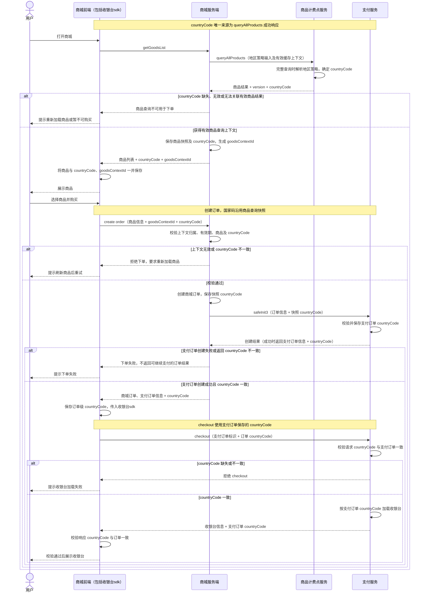

# 商城 countryCode 全链路一致性需求

## 1. 需求目标与范围

商品查询、创建订单和拉起收银台 `checkout` 必须使用同一个 `countryCode`，确保用户看到的商品地区与订单、收银台使用的地区一致。

**唯一国家码来源为商品计费点服务 `queryAllProducts` 成功响应中的 `data.countryCode`。** 商城服务端保存该值，下单时传给支付服务 `safeInit3`，支付服务将其保存到支付订单，`checkout` 使用支付订单中保存的值。

本文覆盖商品查询至 `checkout` 的字段传递、保存、校验及异常处理。后续 `prepay` 沿用支付订单的国家码；支付成功与游戏发货流程见[商城支付与发货时序图](payment-fulfillment-sequence.md)。

## 2. 现状与改造依据

根据提供的 `/apiv3/game/queryAllProducts` 接口说明：

- 响应已经定义可选的 `data.countryCode`：数据库商品分支返回地区策略选出的国家，版本短路分支回显请求值；未选出国家或旧配置回退时可能省略。
- 请求 `countryCode` 表示调用方上次保存的查询国家，仅参与版本短路比较，不能指定本次计价国家，也不能替代 `storeCountryCode`。
- 地区策略可使用 IP 国家、用户注册国家和商店国家选择国家及币种。是否选择出国家、来源顺序和默认币种由运行时配置决定。
- 版本匹配且请求 `countryCode` 为空白时，也可能直接返回 `products=[]` 并省略响应国家码；短路时不会重新解析地区来源。
- 旧配置回退可能返回无国家码、无价格的商品；`products=[]` 也不一定表示缓存命中。
- 同一国家下，不同商品可能回退到各自的默认币种，不能由商品币种反推国家。

因此，本次“响应增加 countryCode”在现有接口上落实为：**强化响应字段约定并补齐相关分支，同时新增商城到支付的全链路传递和保存规则。** 以下新增字段与校验规则属于目标需求，不代表现有服务已经实现。

## 3. 核心约定

### 3.1 唯一来源与一致性

字段名统一使用 `countryCode`。商品计费点服务输出标准化的 ISO 3166-1 alpha-2 两位大写国家码，例如 `JP`、`US`；下游按返回值原样传递和保存。

对于同一次商品查询上下文创建的订单，必须满足：

```text
queryAllProducts.data.countryCode
  = 商品查询上下文.countryCode
  = getGoodsList 响应.countryCode
  = create order 请求.countryCode
  = 商城订单.countryCode
  = safeInit3 请求.countryCode
  = 支付订单.countryCode
  = safeInit3 响应.countryCode
  = create order 响应.countryCode
  = checkout 请求.countryCode
  = checkout 实际使用的 countryCode
  = checkout 响应.countryCode
```

IP、注册国家和 `storeCountryCode` 可以作为商品计费点服务的地区策略输入；商城前端、商城服务端和支付服务不得在后续阶段重新计算国家、用其他地区值覆盖该值，或按币种推导国家。

### 3.2 商品查询上下文

商城服务端需要保存一次成功商品查询的上下文，并提供可关联该上下文的标识。本文建议新增字段名 `goodsContextId`，用于关联服务端快照，不是新的国家来源。

上下文至少包含：游戏、平台、用户、商品版本、`countryCode`、商品及其实际币种和价格、有效期。标识必须绑定当前用户及游戏、平台，避免不同用户或不同查询之间混用。

- 商城服务端从 `queryAllProducts` 响应写入上下文，不从前端请求生成国家码。
- 前端提交 `goodsContextId + countryCode`，商城服务端与对应上下文校验；校验通过后，使用服务端保存的国家码创建订单并调用 `safeInit3`。
- 服务端快照是权威依据；前端回传的 `countryCode` 只用于一致性校验，不能直接作为可信下单值。
- 同一用户多个页面或多次商品查询可以拥有不同上下文，不能仅按用户存储一个“最新国家”并用于所有订单。
- 已创建订单保存独立国家码快照；后续商品刷新、用户 IP 改变或用户国家缓存更新不修改既有订单。

`goodsContextId` 的具体生成方式和有效期由商城服务端设计，但必须满足上述关联和校验要求。

## 4. 全链路时序图



图中的商品结果可以来自完整查询，也可以来自满足复用条件的缓存短路；短路仅允许复用此前由该接口返回并保存的同一上下文，具体规则见第 6 节。未通过任一阶段的校验时，不继续后续支付流程。

## 5. 各服务及接口改造

| 接口或节点 | 目标字段约定 | 保存与校验要求 |
| --- | --- | --- |
| `queryAllProducts` 请求 | 保留地区策略输入；请求 `countryCode` 仍表示上次查询国家 | 商城传递实际用户来源的 `clientIp`；只从有效服务端上下文读取上次国家码，不将请求国家码作为本次指定国家 |
| `queryAllProducts` 响应 | 可用于本链路下单的成功商品结果必须返回有效 `data.countryCode` | 完整查询由商品计费点服务确定并标准化；无有效国家的结果不得进入下单链路 |
| `getGoodsList` 响应 | 增加 `countryCode`、建议增加 `goodsContextId` | 商城保存服务端上下文，并将国家码、上下文标识和对应商品结果一起返回前端 |
| `create order` 请求 | 增加 `countryCode`、建议增加 `goodsContextId` | 商城校验用户、游戏、平台、上下文有效性和国家码一致性；缺失或不一致时拒绝下单 |
| 商城订单 | 增加持久化字段 `countryCode` | 从商品查询上下文写入，创建后保持固定，并能追溯商品查询上下文 |
| `safeInit3` 请求 | 商城服务端必须传入 `countryCode` | 使用商城订单保存的值；支付服务校验格式，并持久化到支付订单 |
| `safeInit3` 响应 | 返回支付订单标识及保存的 `countryCode` | 商城校验支付订单国家码与商城订单一致；不一致不得继续 checkout |
| `create order` 响应 | 返回订单信息及订单 `countryCode` | 前端以当前订单响应更新订单级上下文，并传给收银台sdk |
| `checkout` 请求 | 携带支付订单标识与 `countryCode` | SDK 使用当前订单国家码；支付服务校验其与对应支付订单一致，不接受覆盖 |
| `checkout` 处理及响应 | 从支付订单读取国家码，响应返回 `countryCode` | 收银台地区配置以订单国家码为准；前端验证响应值后展示收银台 |
| 后续 `prepay` | 沿用支付订单 `countryCode` | 不重新按当前 IP 或其他地区来源定国家；若请求携带国家码，也必须与订单一致 |

支付订单标识、商品字段以及既有响应包装沿用各接口实际协议。本文使用 `safeInit3` 名称，对应既有时序文档中的 `safeinit3`；实际路由和大小写以支付服务协议为准。

### 5.1 字段传递示例

以下为新增及关联字段示意，不是完整请求或响应。`goodsContextId` 为建议字段，订单字段名以各接口实际协议为准。

```json
{
  "goodsContextId": "goods-context-example",
  "countryCode": "JP"
}
```

- `getGoodsList` 响应和 `create order` 请求携带上述商品查询上下文。
- 商城校验通过后，从服务端上下文取出 `JP`，写入商城订单，并在 `safeInit3` 请求中传入 `"countryCode": "JP"`。
- `safeInit3`、`create order` 响应与 `checkout` 请求、响应的 `countryCode` 均为 `JP`，各订单标识关联同一笔交易。

## 6. 商品缓存、缺失字段及地区变化

### 6.1 完整查询与版本短路

1. 首次查询、服务端没有完整商品上下文、上下文过期或地区策略输入变化时，必须获得完整商品查询结果及本次有效国家码。
2. 使用版本短路时，商城必须已保存来源于该接口的有效国家码、版本和商品列表；请求中的 `version + countryCode` 必须取自同一上下文。
3. 仅在业务成功、短路分支可确认、响应版本及国家码与有效上下文匹配、相关地区输入未变化时，才可复用该上下文中的商品。
4. 不能仅凭 `products=[]` 判断可复用缓存；无匹配上下文、国家码缺失或响应不一致时，重新完整查询，不能将空列表误当成可下单商品。
5. 商品计费点服务需要调整短路判定或提供明确的完整查询机制，保证需要刷新时确实重新解析地区策略。仅清空请求 `countryCode`，或仅传 `version=0`，不作为可靠的强制刷新约定。
6. 按用户维度保存的国家币种缓存可以用于商品服务内部判断，不能替代商城保存的商品上下文或订单国家码。

### 6.2 countryCode 缺失与旧配置回退

- 当地区策略未选出国家或策略未启用时，如需继续支持购买，应由商品计费点服务通过明确的默认国家策略确定国家，并在响应中返回；默认币种本身不能充当默认国家。
- 旧配置回退如需支持本链路购买，必须在商品计费点服务侧补齐国家码，以及可用于购买的商品计价数据。
- 未补齐前，缺失、空白或无效 `countryCode` 的商品结果不可用于本链路下单；商城提示重新加载或暂不可购买，不自行填充 IP 国家、注册国家或固定国家。
- 如果已拿到有效国家码但商品采用默认币种，仍保留该国家码，并使用该商品实际返回的币种和价格；不能因币种回退而改写国家。

### 6.3 地区与查询上下文变化

- 创建订单前，如地区策略相关输入变化，或商品上下文失效，应刷新商品并让用户基于新结果发起购买，不能在下单时静默换国家。
- 同一用户多页面分别按各自的有效商品查询上下文下单，不能以最近一次查询覆盖另一页面的国家码。
- 订单创建后即固定国家码。用户改变 IP、重新查询商品或重开收银台时，该订单仍使用原值；前端不得拿最新商品列表国家码替换旧订单国家码。
- 重试 `safeInit3` 或 `checkout` 时，使用同一订单快照及既有订单重试约定；不得在重试中重新定国家。

## 7. 异常处理与可追踪性

| 情况 | 处理要求 |
| --- | --- |
| `queryAllProducts` 业务失败 | 不创建有效商品查询上下文；按业务 `code` 判断成功，不仅看 HTTP 状态 |
| 商品响应国家码缺失或无效 | 不允许下单；完整查询或提示暂不可购买 |
| 商品上下文不存在、过期、归属不符或商品不匹配 | 拒绝下单并要求重新加载商品 |
| 前端下单国家码与商品上下文不同 | 拒绝下单；不调用 `safeInit3` |
| `safeInit3` 国家码缺失或无效 | 支付服务拒绝本链路创建支付订单 |
| `safeInit3` 失败或响应国家码与商城订单不同 | 不返回可继续支付的成功结果，不进入 checkout；保留关联订单用于排查 |
| checkout 请求国家码缺失或与支付订单不同 | 拒绝 checkout，不覆盖支付订单国家码 |
| checkout 响应国家码与前端订单不同 | 前端停止展示收银台，不继续 prepay，并反馈异常 |

接口应提供可识别的业务错误类别，具体错误码由接口设计确定。服务端记录商品查询上下文标识、商品版本、商城订单标识、支付订单标识及各阶段国家码，便于核对来源和定位不一致阶段。

`queryAllProducts` 新增或补齐响应字段后，按既有响应签名协议处理包含 `countryCode` 的实际 `data`；商城验签通过后再接受该响应。

## 8. 验收标准

| 场景 | 预期结果 |
| --- | --- |
| 正常查询返回 `JP` | 商品查询上下文、商城订单、`safeInit3`、支付订单和 checkout 请求、处理、响应全部使用 `JP` |
| 正常查询返回 `US` | 同一链路各阶段全部使用 `US` |
| 前端 IP 国家与商品响应国家不同 | 以商品响应国家为准，不被前端或支付服务重新推导的国家覆盖 |
| 商品使用默认币种 | 国家码仍为商品响应值，金额和币种使用对应商品实际结果 |
| 国家码缺失、空白或格式无效 | 无法进入可支付下单链路，不由商城补默认国家 |
| 版本短路且有匹配有效上下文 | 复用同一上下文商品和国家码，不丢失国家码 |
| 空列表且没有有效上下文或无法确认短路 | 不复用无来源商品，不允许下单，触发完整查询或失败提示 |
| 版本相同但地区策略输入变化 | 不复用旧短路结果，重新查询商品和国家；用户基于新商品结果下单 |
| 旧配置回退缺少国家码或计价数据 | 不进入本链路购买；补齐服务端结果后才可继续 |
| 前端篡改下单国家码、混用上下文或上下文过期 | 商城拒绝下单，不调用 `safeInit3` |
| 同一用户两个页面分别查询 `JP` 和 `US` | 各页面订单使用各自有效查询上下文，不互相覆盖 |
| `safeInit3` 返回国家码与商城订单不同 | 下单不返回可继续支付的成功结果 |
| checkout 请求国家码与支付订单不同 | 支付服务拒绝 checkout，订单国家码保持原值 |
| checkout 响应国家码与前端订单不同 | 前端停止展示收银台，不继续支付 |
| 订单创建后 IP 改变或查询到新国家 | 既有订单再次 checkout 时仍使用创建时国家码 |
| 同一订单重试创建支付订单或重开收银台 | 各次使用相同订单国家码，按既有重试约定处理 |

## 9. 联调前需落实的协议项

- 商品计费点服务：无国家和旧配置回退分支的返回约定、默认国家配置、地区变化时的完整查询机制。
- 商城服务端：商品查询上下文标识的最终字段名、有效期，以及 `getGoodsList` 和 `create order` 的请求响应包装。
- 支付服务及收银台sdk：`safeInit3` 的实际路由与字段名、订单国家码持久化、checkout 请求校验及响应回显。
- 各服务：缺失、不一致、上下文过期等业务错误码，以及新增校验对存量订单的上线兼容安排。存量订单不能用当前 IP 或最新商品查询结果静默补写历史国家。
