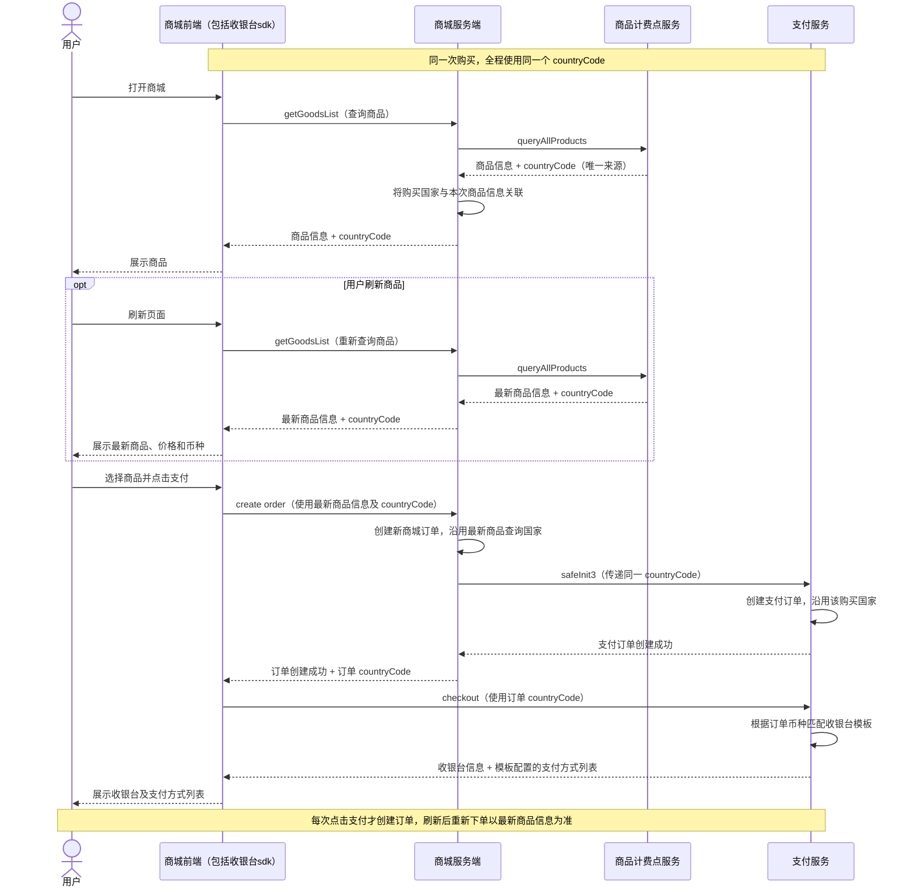

# 商城购买国家一致性 PRD（countryCode）

## 1. 需求背景

海外商城根据国家提供商品和支付服务。如果商品展示、下单与收银台分别使用不同的国家判断结果，用户可能在购买过程中遇到币种、价格或可用支付方式的非预期变化，影响购买体验。

本需求统一一次购买所使用的国家：商品查询确定国家，下单与收银台沿用该国家，让用户基于商品页看到的信息完成购买。

本文中的“购买国家”指本次商品查询确定的业务国家，以 `countryCode` 表示，例如日本为 `JP`、美国为 `US`。

## 2. 产品目标

1. **来源统一**：以商品计费点服务 `queryAllProducts` 响应中的 `countryCode` 作为唯一购买国家来源。
2. **购买过程一致**：查询商品、创建订单、打开收银台使用同一个购买国家。
3. **下单依据明确**：用户每次点击支付才创建订单，刷新后重新下单以最新商品信息为准。
4. **异常有明确反馈**：无法确定购买国家或发现国家不一致时，停止继续支付，并引导用户重试。

例如，用户首次查询到 `JP` 商品，刷新后查询到 `US` 商品，再点击支付，则新建订单及收银台均使用最新的 `US`，币种与价格也以刷新后的商品信息为准。

## 3. 需求范围

| 环节 | 本次需求 |
| --- | --- |
| 查询商品 | 商品计费点服务返回购买国家，商城将该国家与本次商品信息关联 |
| 创建订单 | 用户每次点击支付时创建订单，使用当前页面最新查询的商品信息；商城通过 `safeInit3` 传递同一 `countryCode` |
| 打开收银台 | `checkout` 沿用订单购买国家，并根据订单币种匹配收银台模板，返回模板配置的支付方式列表 |
| 异常与重复操作 | 明确国家缺失、国家不一致、刷新后重新下单和多页面购买的业务规则 |

国家选择策略、商品定价规则、税费与优惠规则沿用已有业务约定。本次不新增国家选择入口，也不调整支付成功与游戏发货流程；后者见[商城支付与发货时序图](payment-fulfillment-sequence.md)。

## 4. 核心业务规则

### 4.1 一个来源

购买国家只能来自商品计费点服务 `queryAllProducts` 的响应。商城及支付环节不得自行用当前 IP、注册国家或商品币种替换该国家。

商品计费点服务需要在可购买商品的查询结果中明确返回 `countryCode`。无法提供有效购买国家时，该结果不能用于下单。

### 4.2 一次购买使用同一个国家

用户点击支付时，商城订单、支付订单和收银台必须沿用当前页面最新商品查询的购买国家。

**商品查询国家 = 商城订单国家 = 支付订单国家 = 收银台国家。**

不得在下单或打开收银台时静默切换国家。因地区变化需要更新商品信息时，应先让用户刷新并重新确认购买。

### 4.3 每次点击支付创建订单，刷新后以最新信息为准

- 浏览商品、选择商品或刷新页面时不创建订单；用户每次点击支付时才创建订单。
- 刷新后，如果商品价格、币种、购买国家或可购买状态变化，页面展示最新结果，用户重新确认并点击支付后，按最新结果创建新订单。
- 重新下单使用最新商品信息及其 `countryCode`，收银台根据新订单币种匹配模板。
- 重新下单不复用刷新前的订单。已创建订单保留其创建时的商品信息和购买国家。

“全链路一致”适用于每次下单对应的查询结果、订单与收银台，不要求刷新前后两次下单使用相同国家。

### 4.4 多次购买互不影响

用户同时打开多个商城页面时，各笔订单以用户购买时所对应的商品查询国家为准，不因另一页面刷新商品而改变。

用户再次点击支付时，按当前页面最新的有效商品信息创建新订单。

### 4.5 国家与币种分别遵循业务规则

国家用于统一本次购买的地区依据，商品实际币种和价格仍以商品服务提供的结果为准。

若某商品按已有规则使用默认币种，不能据此反推或改写购买国家。本次不新增“一个国家只能对应一种币种”的规则。

### 4.6 支付方式按币种匹配收银台模板

打开收银台时，支付服务根据订单的实际支付币种匹配收银台模板，并返回该模板配置的支付方式列表，商城前端按返回结果展示。

- 购买国家在商品查询、下单和收银台环节保持一致；收银台模板的匹配依据为订单币种。
- 商品采用默认币种时，收银台使用该订单实际采用的币种匹配模板，不按购买国家推导另一种币种。
- 例如，订单币种为 `JPY` 时匹配 `JPY` 对应的模板；订单币种为 `USD` 时匹配 `USD` 对应的模板。

## 5. 用户流程与阶段要求

### 5.1 查询商品

用户打开商城，系统查询商品及本次购买国家，并展示商品信息。

- 可购买的商品结果必须包含有效的购买国家。
- 商品信息与购买国家应对应同一次查询结果。
- 刷新或重新进入商城后，仍需保证展示商品具有明确的购买国家。
- 用户无需理解或手动输入 `countryCode`。

### 5.2 创建订单

用户选择商品后，每次点击支付，商城才基于当前页面最新商品信息创建订单。

- 浏览、选购和刷新商品不触发创建订单。
- 刷新后重新下单，商品价格、币种、购买国家和可购买状态均以最新查询结果为准。
- 商城服务端向支付服务调用 `safeInit3` 时，必须传递同一个 `countryCode`。
- 商城订单和支付订单的购买国家必须一致。
- 订单币种沿用本次所购商品的实际币种，供收银台匹配模板。
- 如果商品信息已失效或购买国家不一致，不继续支付；引导用户刷新商品并重新确认购买。

### 5.3 打开收银台

订单创建成功后，商城拉起收银台。

- `checkout` 使用该订单的购买国家。
- 支付服务根据订单币种匹配收银台模板，返回模板配置的支付方式列表。
- 商城前端展示返回的支付方式列表，用户从中选择支付方式。
- 当前网络或新的商品查询结果不改变该订单的购买国家和币种。
- 用户刷新商品后再次点击支付时，打开新建订单对应的收银台，按新订单币种匹配模板。
- 无法保证收银台与订单国家一致时，不进入后续支付。

## 6. 业务时序图

以下展示正常购买流程，异常情况见第 7 节。

## 7. 异常场景与用户反馈

以下提示文案为简体中文建议，其他语言按现有多语言流程配置。对用户表达业务结果，不展示国家码、接口名或内部校验信息。

| 场景 | 产品处理 | 建议提示与操作 |
| --- | --- | --- |
| 商品查询失败，或无法确定购买国家 | 不提供可继续下单的购买入口 | “商品暂时无法加载，请稍后重试。”；提供“重新加载” |
| 下单前商品信息失效，或购买国家发生变化 | 停止本次下单，刷新商品后由用户重新确认 | “商品信息已更新，请刷新后重新购买。”；提供“刷新商品” |
| 创建订单失败，或商城订单与支付订单国家不一致 | 不继续打开收银台 | “订单创建失败，请重试。”；提供“重试” |
| 收银台加载失败，或无法与订单国家保持一致 | 不继续支付；返回商品页，用户重新点击支付时按最新有效商品信息创建新订单 | “暂时无法打开收银台，请重新发起支付。”；提供“返回商品页” |

重试仍不能确定国家或保证一致时，继续保持购买或支付不可用，不通过自动换国家恢复流程。

## 8. 验收标准

| 场景 | 验收结果 |
| --- | --- |
| 商品查询返回日本 `JP` | 商品查询、商城订单、支付订单和收银台全部使用 `JP`；`safeInit3` 传递 `JP` |
| 商品查询返回美国 `US` | 商品查询、商城订单、支付订单和收银台全部使用 `US`；`safeInit3` 传递 `US` |
| 当前网络判断的国家与商品查询国家不同 | 下单和收银台以商品查询国家为准 |
| 商品采用默认币种 | 购买国家不因币种变化被替换，商品币种和价格遵循已有规则 |
| 订单币种为 `JPY` | checkout 匹配 `JPY` 对应收银台模板，返回并展示该模板配置的支付方式列表 |
| 订单币种为 `USD` | checkout 匹配 `USD` 对应收银台模板，返回并展示该模板配置的支付方式列表 |
| 商品采用默认币种，且与购买国家通常使用的币种不同 | 按订单实际币种匹配收银台模板，购买国家保持原值 |
| 商品结果缺少有效购买国家 | 用户不能继续下单，并获得重新加载提示 |
| 下单时国家不一致或商品信息失效 | 不继续支付，提示刷新商品并重新确认购买 |
| 商城订单与支付订单国家不一致 | 不进入收银台，并提示订单创建失败 |
| 收银台与订单国家不一致 | 不继续支付，并引导返回商品页重新发起支付 |
| 用户浏览、选择商品或刷新页面 | 不创建订单 |
| 用户每次点击支付 | 创建新订单，使用当前页面最新有效商品信息 |
| 订单创建后用户切换网络 | 当前订单和对应收银台仍使用创建时的购买国家 |
| 用户刷新商品后价格、币种或国家变化，再点击支付 | 按最新信息创建新订单，不复用刷新前订单；收银台按新订单币种匹配模板 |
| 最新商品已不可购买 | 不允许基于刷新前的商品信息下单 |
| 同一用户在不同页面分别基于 `JP`、`US` 商品下单 | 两笔订单各自沿用对应国家，不互相覆盖 |
| 商品信息被复用或重复加载 | 仍能明确对应的购买国家，不丢失或混用国家信息 |
| 用户重新点击支付 | 创建新订单；该次下单的商品查询国家、订单国家和收银台国家一致 |

## 9. 上线前业务确认

- 确认所有支持购买的商品场景都能提供购买国家，包括使用默认商品配置的场景。
- 无法确定国家时，按“暂不可购买”处理；如需启用默认国家，应先明确业务规则，并由商品计费点服务统一返回。
- 明确上线前已创建、尚未完成订单的处理方案；无法确认原购买国家的订单，不直接套用当前国家继续支付。
- 确认异常提示、重试入口及多语言文案已覆盖商品页、下单和收银台三个环节。
- 确认支持的订单币种均有对应收银台模板，并明确未匹配模板或模板无可用支付方式时的处理规则。
