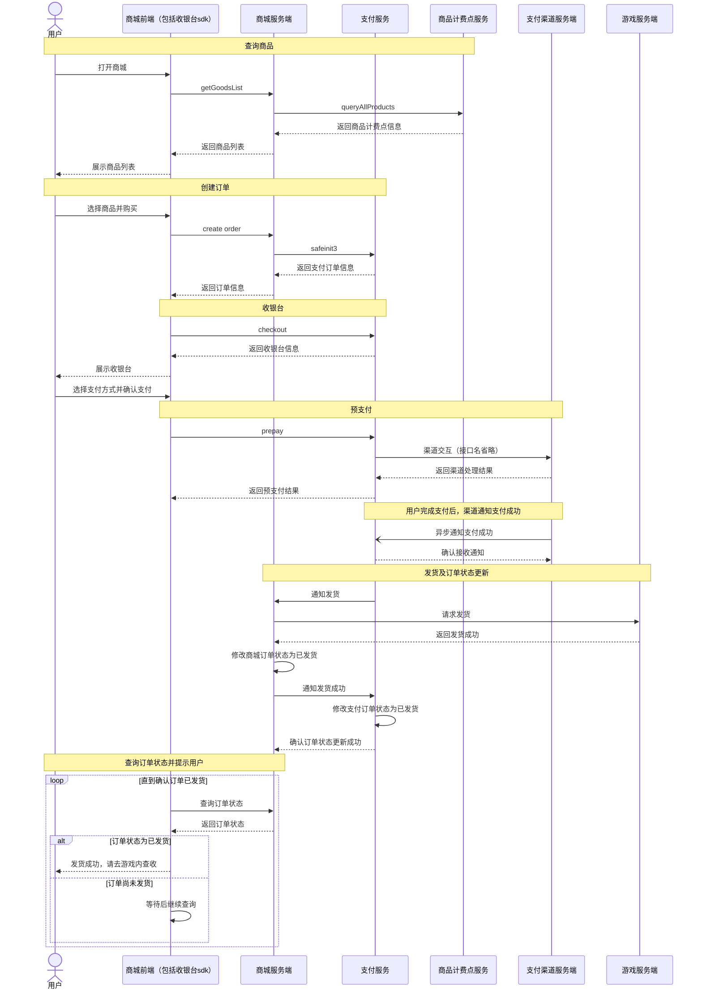

# 商城支付与发货时序图

## 1. 文档范围

本文描述海外版充值商城从查询商品、创建订单、收银台、预支付，到支付成功通知、游戏发货、订单状态更新及用户提示的完整成功流程，用于接口联调与流程评审。

## 2. 参与角色

| 角色 | 职责 |
| --- | --- |
| 用户 | 浏览商品、发起购买、确认支付，并接收发货成功提示 |
| 商城前端（包括收银台sdk） | 展示商品和收银台，调用商城与支付接口，查询订单状态并提示用户 |
| 商城服务端 | 查询商品计费点、创建商城订单、向支付服务创建支付订单、请求游戏发货并维护商城订单状态 |
| 支付服务 | 创建支付订单、提供收银台和预支付能力、接收渠道支付成功通知、通知商城发货并维护支付订单状态 |
| 商品计费点服务 | 提供商品计费点信息 |
| 支付渠道服务端 | 处理渠道支付交互，并异步通知支付成功 |
| 游戏服务端 | 执行游戏内发货，并返回发货结果 |

## 3. 接口与交互

| 调用方 | 接收方 | 接口或交互 | 说明 |
| --- | --- | --- | --- |
| 商城前端（包括收银台sdk） | 商城服务端 | `getGoodsList` | 查询商品列表 |
| 商城服务端 | 商品计费点服务 | `queryAllProducts` | 查询商品计费点信息 |
| 商城前端（包括收银台sdk） | 商城服务端 | `create order` | 创建商城订单 |
| 商城服务端 | 支付服务 | `safeinit3` | 创建支付订单 |
| 商城前端（包括收银台sdk） | 支付服务 | `checkout` | 获取收银台信息 |
| 商城前端（包括收银台sdk） | 支付服务 | `prepay` | 发起预支付 |
| 支付服务 | 支付渠道服务端 | 渠道交互 | 接口名省略 |
| 支付渠道服务端 | 支付服务 | 支付成功通知 | 异步通知支付成功，接口名省略 |
| 支付服务 | 商城服务端 | 通知发货 | 具体接口名未指定 |
| 商城服务端 | 游戏服务端 | 请求发货 | 具体接口名未指定 |
| 商城服务端 | 支付服务 | 通知发货成功 | 同步游戏发货成功结果，具体接口名未指定 |
| 商城前端（包括收银台sdk） | 商城服务端 | 查询订单状态 | 具体接口名未指定 |

## 4. 时序图

## 5. 流程说明

1. **查询商品**：用户打开商城，前端调用 `getGoodsList`；商城服务端调用 `queryAllProducts` 获取商品计费点信息，再返回商品列表。
2. **创建订单**：用户选购商品，前端调用 `create order`；商城服务端通过 `safeinit3` 向支付服务创建支付订单，并将订单信息返回前端。
3. **收银台与预支付**：前端调用 `checkout` 获取并展示收银台；用户选择支付方式并确认后，前端调用 `prepay`，由支付服务完成渠道交互并返回预支付结果。
4. **支付成功通知**：用户完成支付后，支付渠道服务端异步通知支付服务支付成功；支付服务确认接收通知。
5. **游戏发货与状态更新**：支付服务通知商城服务端发货，商城服务端请求游戏服务端发货。游戏服务端返回发货成功后，商城服务端将商城订单改为“已发货”，并通知支付服务将支付订单改为“已发货”。
6. **用户提示**：商城前端查询商城订单状态；尚未发货时等待后继续查询，确认“已发货”后停止查询，并提示用户“发货成功，请去游戏内查收”。

## 6. 流程约定

- 图中假设 `getGoodsList` 会触发商城服务端调用 `queryAllProducts`。
- 预支付结果与支付成功通知是两个独立步骤；预支付返回后，支付渠道在用户完成支付后异步通知支付成功。
- 游戏服务端返回发货成功后，商城服务端和支付服务分别更新各自的订单状态为“已发货”。
- 商城前端以商城服务端返回的“已发货”状态作为展示发货成功提示的依据。
- 支付渠道接口名省略；发货通知、发货结果通知和订单状态查询使用交互描述，具体接口名尚未指定。
- 本图描述成功流程；异常、重试及轮询间隔和超时策略另行约定。
